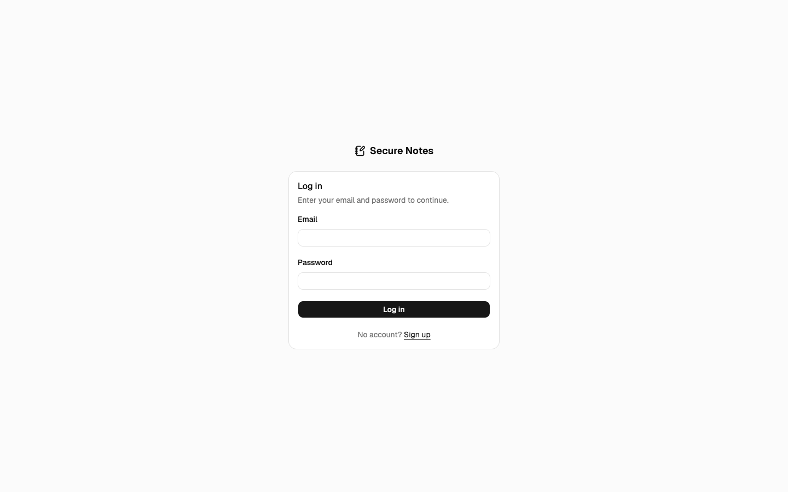
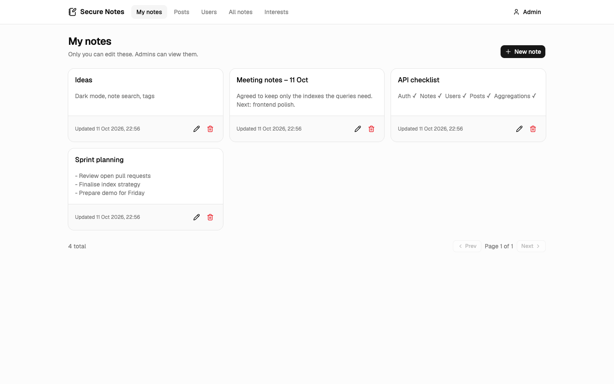
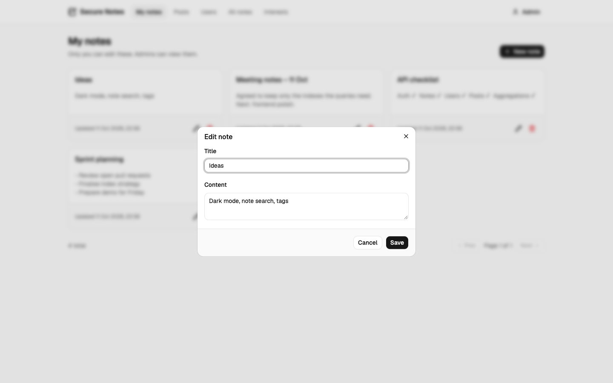
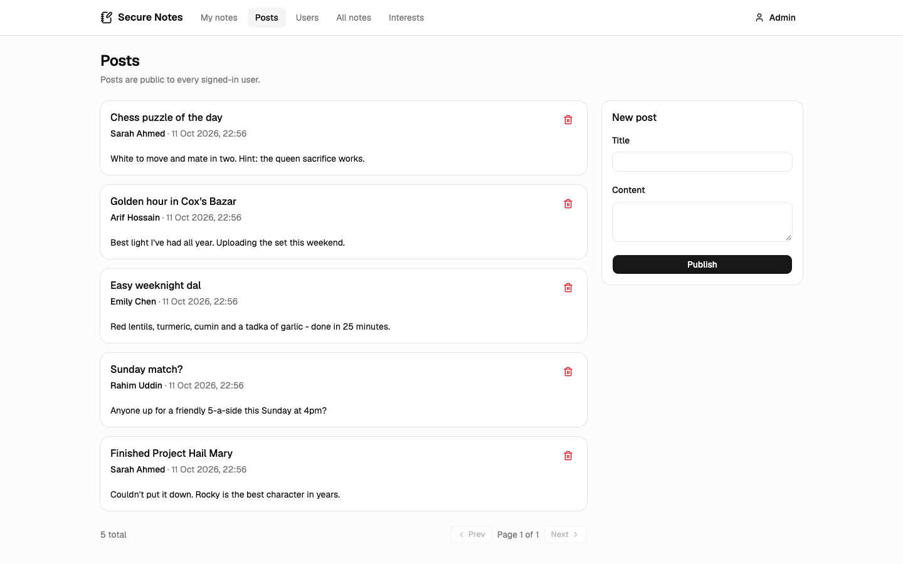
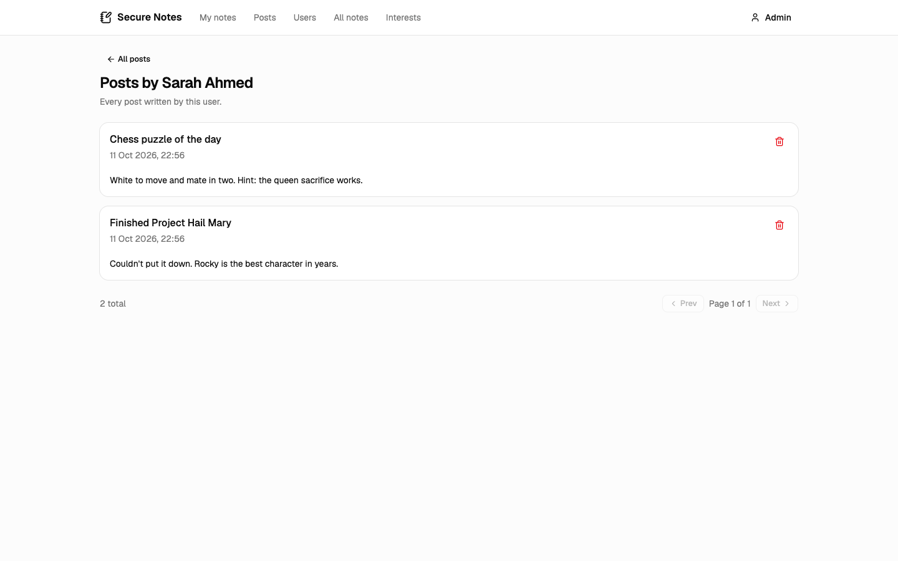
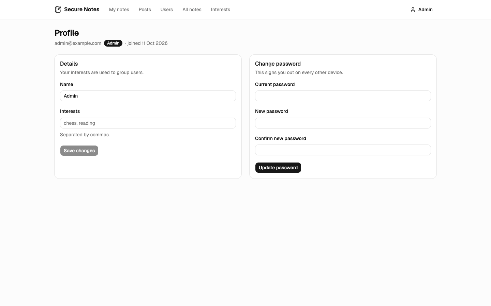
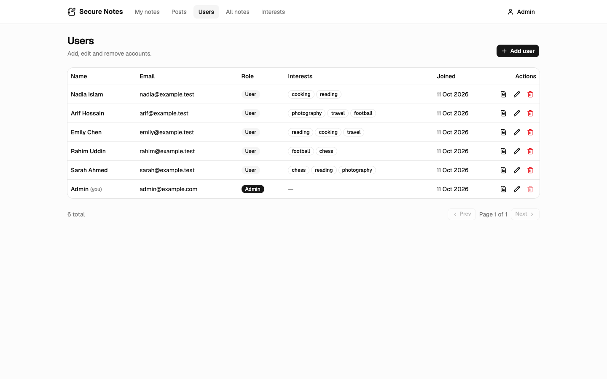
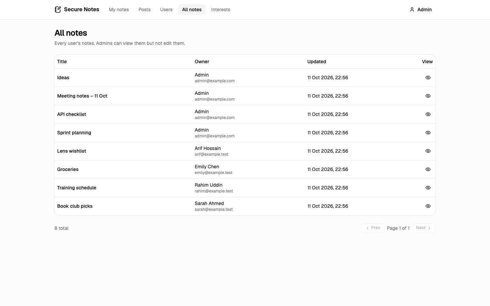
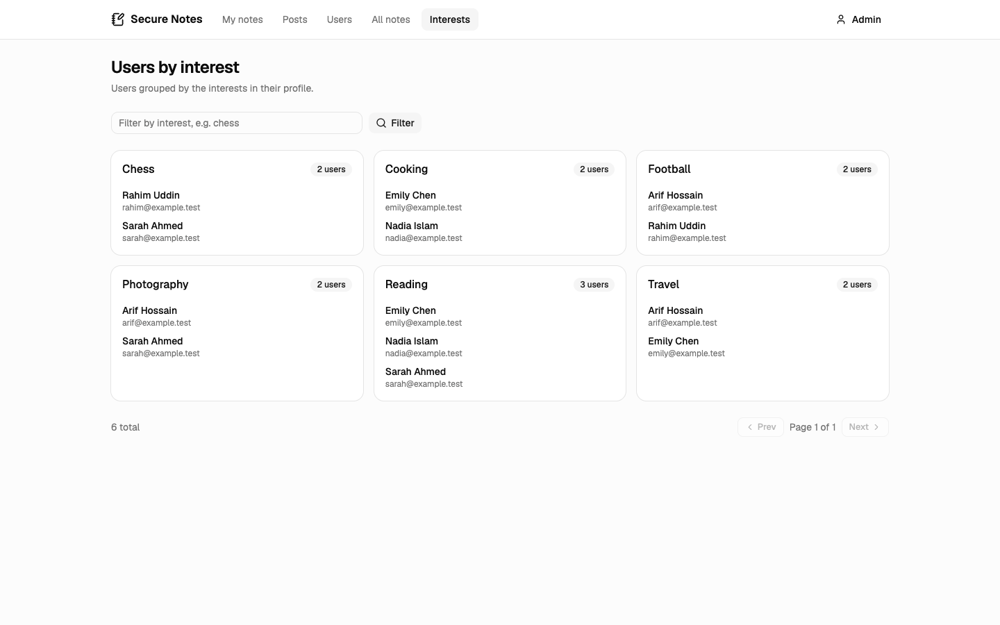

# Secure Notes — Frontend

**Secure Notes** is a note-taking platform with secure authentication and role-based access control.
Users write private notes and public posts; admins manage users, can read everyone's notes and see
users grouped by interest.

The project is split into two repositories:

- **Frontend** (this repo) — React + TypeScript single-page app built with Vite, Tailwind CSS and shadcn/ui.
- **[Backend](https://github.com/Dipjitbaroi/secure-note-taking-application-backend)** — REST API with
  Express, TypeScript, MongoDB/Mongoose and JWT, focused on indexing and aggregation pipelines.

## Live

| | URL |
| --- | --- |
| Web app | https://secure-note-taking-application-fron-five.vercel.app |
| API | https://secure-note-taking-application-back.vercel.app/api/v1 ([health](https://secure-note-taking-application-back.vercel.app/api/v1/health)) |

Sign up to try it as a normal user. Admin features need an admin account (see the backend's
`npm run seed:admin`).

## Screenshots

| | |
| --- | --- |
| **Login**<br> | **My notes**<br> |
| **Editing a note**<br> | **Posts feed**<br> |
| **Posts by one user** (`$lookup` aggregation)<br> | **Profile**<br> |
| **Admin – users**<br> | **Admin – all notes**<br> |
| **Admin – users by interest** (aggregation)<br> | |

## Features

- Sign up, log in, log out, change password
- Notes: create, edit, delete and list your own notes (paginated)
- Posts: public feed, write and edit your posts, view all posts of a user
- Profile: name and interests
- Admin: add / edit / delete users and change roles, read everyone's notes with an owner filter,
  users grouped by interest with a filter
- Session handling: the access token is kept in memory; the refresh token is stored and used to get a new
  access token on page load or when a request returns 401

## Tech stack

React 19, TypeScript, Vite, Tailwind CSS v4, shadcn/ui (Base UI), React Router, TanStack Query,
react-hook-form, Zod, axios.

## Getting started

Requirements: Node.js 20+ and the [backend](https://github.com/Dipjitbaroi/secure-note-taking-application-backend)
running locally (default `http://localhost:4000`) or the deployed API.

```bash
git clone https://github.com/Dipjitbaroi/secure-note-taking-application-frontend.git
cd secure-note-taking-application-frontend
npm install
cp .env.example .env
npm run dev          # http://localhost:5173
```

### Environment variables

| Variable | Description |
| --- | --- |
| `VITE_API_URL` | API base URL. Use `/api/v1` to go through the Vite dev proxy to a local backend, or the full URL of a deployed API. |
| `VITE_PROXY_TARGET` | Optional. Where the dev proxy sends `/api` requests (default `http://localhost:4000`). |

### Scripts

| Command | |
| --- | --- |
| `npm run dev` | Start the dev server |
| `npm run build` | Type-check and build to `dist/` |
| `npm run preview` | Serve the production build locally |
| `npm run lint` | Lint with oxlint |

## Project structure

```
src/
  lib/          api client (token refresh), query client, token storage, helpers
  types/        API response types
  features/     auth, notes, posts, users – api calls, hooks, schemas, feature components
  pages/        route pages (admin pages in pages/admin)
  components/   layout, shared components and shadcn/ui primitives
```

## Routes

| Route | Access | |
| --- | --- | --- |
| `/login`, `/register` | guests | |
| `/notes` | users | own notes |
| `/posts` | users | public feed |
| `/users/:id/posts` | users | all posts by one user |
| `/profile` | users | name, interests, password |
| `/admin/users` | admins | user management |
| `/admin/notes` | admins | everyone's notes |
| `/admin/interests` | admins | users grouped by interest |

## Deployment

Deployed on Vercel. `vercel.json` uses the Vite preset and rewrites every path to `index.html` so
client-side routes work on refresh. Set `VITE_API_URL` in the Vercel project to the deployed API URL.
